<p align="center">
  <picture>
    <source media="(prefers-color-scheme: dark)" srcset="docs/branding/xconfig-logo.svg">
    <source media="(prefers-color-scheme: light)" srcset="docs/branding/xconfig-logo-on-light.svg">
    
  </picture>
</p>

# xConfig für Autodarts

> **Inoffizielle Erweiterung für Autodarts.** xConfig ergänzt die Spielansicht um Designvorlagen, besser lesbare Anzeigen und optionale visuelle oder akustische Effekte. Die Spielregeln und die Darterkennung werden nicht verändert.

Alle Einstellungen werden direkt über die xConfig-Oberfläche in Autodarts verwaltet. Einzelne Effekte können unabhängig aktiviert werden; eine vorhandene Konfiguration bleibt bei Updates erhalten.

## Produktvorschau

Die folgenden Aufnahmen zeigen den **aktuellen xConfig-Renderer in einem reproduzierbaren Browser-Testaufbau**. Sie sind keine Aufnahmen aus einem angemeldeten Autodarts-Match. Die Spielbeispiele in den Funktionsabschnitten ergänzen diese Oberfläche.

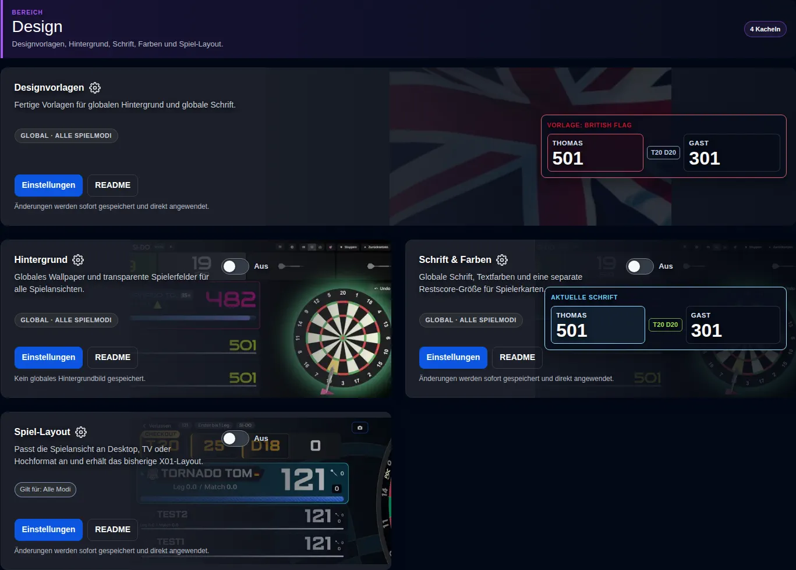

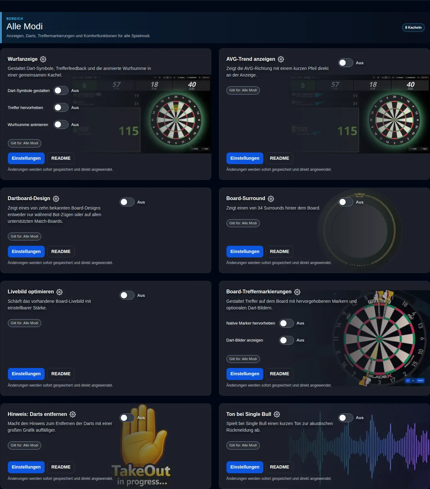

## Installieren

1. Installiere [Tampermonkey](https://www.tampermonkey.net/) in einem unterstützten Browser. Die dokumentierten Test-Baselines sind Chrome/Chromium 111+ und Firefox 121+; eine Live-Kompatibilitätsgarantie für jede Version ist das nicht.
2. Aktiviere in den Erweiterungseinstellungen von Tampermonkey die Ausführung von Nutzerscripts. Falls Tampermonkey einen Injection- oder Berechtigungshinweis anzeigt, folge diesem. Den Dateizugriff benötigst du nicht pauschal für die Autodarts-Webseite.
3. Installiere das aktuelle stabile Userscript über den Button:

   [](https://github.com/thomasasen/autodarts-xconfig/releases/latest/download/autodarts-xconfig.user.js)

4. Bestätige die Installation der Datei `autodarts-xconfig.user.js` in Tampermonkey.
5. Lade [play.autodarts.com](https://play.autodarts.com/) neu. Öffne rechts oben das Profilmenü und wähle **xConfig** direkt unter `Legal`.

**Nur `.user.js` installieren.** Die Datei `autodarts-xconfig.meta.js` ist für die automatische Update-Prüfung bestimmt und wird nicht manuell installiert. Das Userscript läuft gemäß Metadaten auf `https://play.autodarts.com/*`, mit Ausnahme der Board-Verwaltungsseiten unter `/boards`.

<details>
<summary>Tampermonkey: Berechtigungen und Injection-Hinweise</summary>

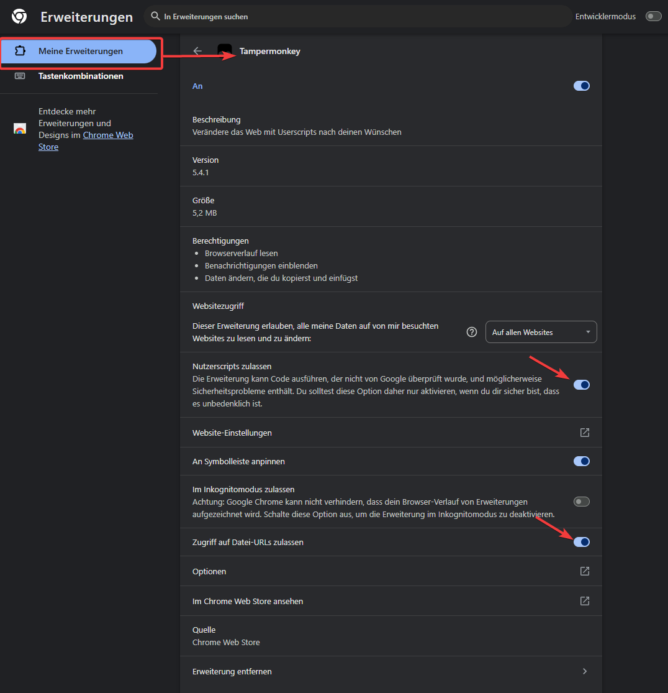

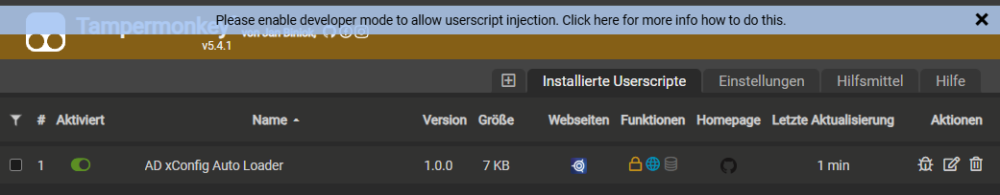

Die konkreten Schalter unterscheiden sich je nach Browser und Tampermonkey-Version. Das Userscript nutzt lokale Konfigurationsspeicherung und kann freigegebene GitHub-Ressourcen laden. Es benötigt keine Autodarts-Anmeldedaten.
</details>

[Alle Releases](https://github.com/thomasasen/autodarts-xconfig/releases) · [Änderungsübersicht](CHANGELOG.md)

## Nach der Installation

Bei einer wirklich frischen Installation ohne gespeicherte xConfig-Konfiguration wird das Profil `Empfohlene Standards` vorbereitet. Es sind ausgewogene Presets vorbereitet; alle Module bleiben zunächst ausgeschaltet. Eine bestehende Konfiguration bleibt dagegen unverändert.

1. Öffne **xConfig** im Profilmenü direkt unter `Legal`.
2. Wähle unter **Design** eine Vorlage oder stelle Hintergrund, Schrift und Bildschirmprofil einzeln ein.
3. Aktiviere in **Alle Modi**, **X01** und **Cricket / Tactics** nur die benötigten Funktionen.
4. Öffne bei Bedarf über **Einstellungen** die Detailoptionen. Änderungen werden direkt gespeichert.
5. Verwende **Exportieren** für eine Sicherung deiner Konfiguration, bevor du größere Änderungen vornimmst.

## Im Überblick

- Insgesamt `19` Module: `15` Anzeigen und Komfortfunktionen sowie `4` Designmodule.
- `↺ Zurücksetzen`: Setzt alle Einstellungen vollständig auf Standard zurück, deaktiviert alle Module, schaltet die Diagnose aus und entfernt globales Hintergrundbild sowie Dart-Upload.
- `Empfohlene Standards`: Übernimmt ausgewogene Presets, schaltet alle Module aus und lässt globales Wallpaper sowie Dart-Upload unangetastet.
- `Exportieren` / `Importieren`: Sichert Einstellungen als versioniertes JSON-Backup und übernimmt auch ältere oder teilweise inkompatible Backups fehlertolerant.
- Hintergrundbild: Die Kachel `Hintergrund` verwendet ein gemeinsames Wallpaper oder das Wallpaper der zuletzt angewendeten Vorlage in allen Spielansichten.
- Bildgröße: Für das globale Wallpaper gilt ein empfohlenes Limit von `1,5 MiB`; der separate Dart-Upload wird kompakter gespeichert.

## Wo finde ich was?

| Bereich | Inhalt |
| --- | --- |
| **Design** | Vorlagen, globaler Hintergrund, Schrift, Farben, Glow und Bildschirmprofile |
| **Alle Modi** | Wurfanzeige, Treffermarker, Surrounds, Dartboard, Livebild und Komfortfunktionen |
| **X01** | Restscore, Checkout-Vorschläge und -Ziele, BUST und Board-Zoom |
| **Cricket / Tactics** | Tabellenlayout, Status- und Trefferfeedback sowie Board-Ziele |

**xConfig enthält 24 technische Features in 19 sichtbaren Kacheln.** Vier Kacheln fassen verwandte Funktionen zusammen. Die Schalter innerhalb dieser Kacheln bleiben getrennt: **Wurfanzeige** (3), **Board-Treffermarkierungen** (2), **X01-Restscore** (2) und **Cricket-/Tactics-Tabelle** (2). `Designvorlagen` ist eine Aktionskachel ohne eigenen Aktivierungsschalter.

## So ist eine Kachel aufgebaut

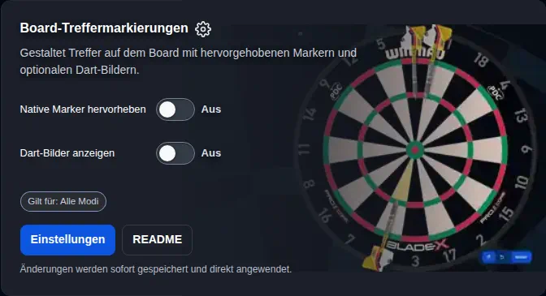

In jeder Kachel findest du eine Vorschau, eine kurze Funktionsbeschreibung, die Gültigkeit für Spielmodi und die Bedienelemente. **Einstellungen** öffnet die Detailansicht, **README** springt zur passenden Modulbeschreibung. Bei zusammengefassten Funktionen lassen sich die einzelnen Teile direkt an der Kachel schalten.

## So sieht das Einstellungsfenster aus

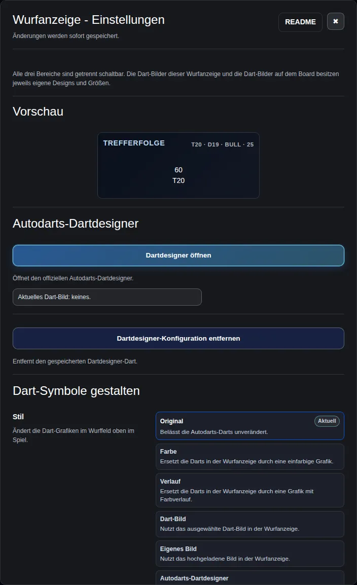

Die Optionen sind nach Teilfunktion gegliedert. Auswahlfelder, Regler und Schalter speichern Änderungen direkt. Die **Diagnose**-Optionen sind für die Fehlersuche gedacht und sollten im normalen Betrieb ausgeschaltet bleiben.

<!-- xconfig-generated:start -->
## Modul-Finder

Wähle den Spielmodus oder den gewünschten sichtbaren Effekt und öffne anschließend die passende Kurzbeschreibung.

| Modul | Bereich | Geeignet für | Kurz erklärt |
| --- | --- | --- | --- |
| [Livebild optimieren](#live-board-enhancement) | Funktion | `alle Modi` | Schärft das vorhandene Board-Livebild mit einstellbarer Stärke. |
| [Board-Surround](#board-surround) | Funktion | `alle Modi` | Zeigt einen von 34 Surrounds hinter dem Board. |
| [Designvorlagen](#theme-global-presets) | Aktion | `alle Modi` | Fertige Vorlagen für globalen Hintergrund und globale Schrift. |
| [Hintergrund](#theme-global-background) | Design | `alle Modi` | Globales Wallpaper und transparente Spielerfelder für alle Spielansichten. |
| [Schrift & Farben](#template-global-typography) | Design | `alle Modi` | Globale Schrift, Textfarben und eine separate Restscore-Größe für Spielerkarten. |
| [Spiel-Layout](#theme-game-layout) | Design | `alle Modi` | Passt die Spielansicht an Desktop, TV oder Hochformat an und erhält das bisherige X01-Layout. |
| [Dartboard-Design](#bot-board-style) | Funktion | `alle Modi` | Zeigt eines von zehn bekannten Board-Designs entweder nur während Bot-Zügen oder auf allen unterstützten Match-Boards. |
| [X01-Restscore](#animation-autodarts-animate-checkout-score-highlight) | Funktion | `X01` | Gestaltet den X01-Restscore mit Finish-Hervorhebung und einem unabhängig schaltbaren Fortschrittsbalken. |
| [Checkout-Ziele hervorheben](#animation-autodarts-animate-checkout-target-highlights) | Funktion | `X01` | Markiert Checkout-Ziele direkt am Board, statt sie nur im Text zu zeigen. |
| [Automatischer Board-Zoom](#animation-autodarts-animate-tv-board-zoom) | Funktion | `X01` | Zoomt in X01 bei Checkout- und sinnvollen Setup-Zielen TV-artig auf das Board. |
| [Checkout-Vorschlag gestalten](#animation-autodarts-checkout-suggestion-styles) | Funktion | `X01` | Vergrößert die Turn-Felder sofort und hebt Checkout-Hinweise theme-kompatibel hervor. |
| [Überworfen (BUST) hervorheben](#animation-autodarts-x01-bust-active-player-highlight) | Funktion | `X01` | Ersetzt den nativen BUST-Effekt durch eine rote Glasbruch-Markierung auf dem gewählten Bereich oder am Darts-Einschlag. |
| [AVG-Trend anzeigen](#animation-autodarts-animate-avg-trend-arrow) | Funktion | `alle Modi` | Zeigt die AVG-Richtung mit einem kurzen Pfeil direkt an der Anzeige. |
| [Cricket-/Tactics-Tabelle](#cricket-tactics-layout) | Funktion | `Cricket`, `Tactics` | Gestaltet die Cricket-/Tactics-Tabelle mit passendem Layout, Zustandsfarben und Trefferfeedback. |
| [Cricket-Ziele hervorheben](#animation-autodarts-animate-cricket-target-highlighter) | Funktion | `Cricket`, `Tactics` | Zeigt Cricket- und Tactics-Zustände direkt auf dem Board statt nur in der Matrix. |
| [Board-Treffermarkierungen](#animation-autodarts-animate-dartboard-marker-highlight) | Funktion | `alle Modi` | Gestaltet Treffer auf dem Board mit hervorgehobenen Markern und optionalen Dart-Bildern. |
| [Hinweis: Darts entfernen](#animation-autodarts-animate-take-out-darts-alert) | Funktion | `alle Modi` | Macht den Hinweis zum Entfernen der Darts mit einer großen Grafik auffälliger. |
| [Ton bei Single Bull](#animation-autodarts-animate-single-bull-hit-sound) | Funktion | `alle Modi` | Spielt bei Single Bull einen kurzen Ton zur akustischen Rückmeldung ab. |
| [Wurfanzeige](#animation-autodarts-animate-turn-score-counter) | Funktion | `alle Modi` | Gestaltet Dart-Symbole, Trefferfeedback und die animierte Wurfsumme in einer gemeinsamen Kachel. |

## Empfohlene Standards

Die Aktion `Empfohlene Standards` übernimmt ausgewogene Presets, schaltet alle Module aus und lässt globales Wallpaper sowie Dart-Upload unangetastet.

[Vollständiges Profil der empfohlenen Standards](docs/FEATURES.md#empfohlene-standards)

## Design

<a id="theme-global-presets"></a>

### Designvorlagen

- Gilt für: `alle Modi`
- Was macht es sichtbar? Wendet Hintergrundbild, Schrift und Farben gemeinsam an, ohne die Darts in der Wurfanzeige zu verändern.
- Wann sinnvoll? Wenn du einen vollständigen Look mit einem Klick auswählen möchtest.

[Alle Einstellungen und Optionen in der Feature-Referenz](docs/FEATURES.md#theme-global-presets)

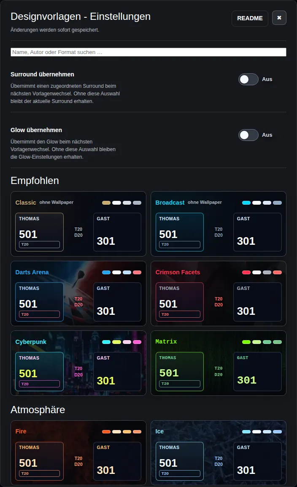

<a id="theme-global-background"></a>

### Hintergrund

- Gilt für: `alle Modi`
- Was macht es sichtbar? Steuert ein gemeinsames Hintergrundbild und die Transparenz der Spielerfelder unter /matches.
- Wann sinnvoll? Wenn alle Spielvarianten denselben Hintergrund erhalten sollen.

[Alle Einstellungen und Optionen in der Feature-Referenz](docs/FEATURES.md#theme-global-background)

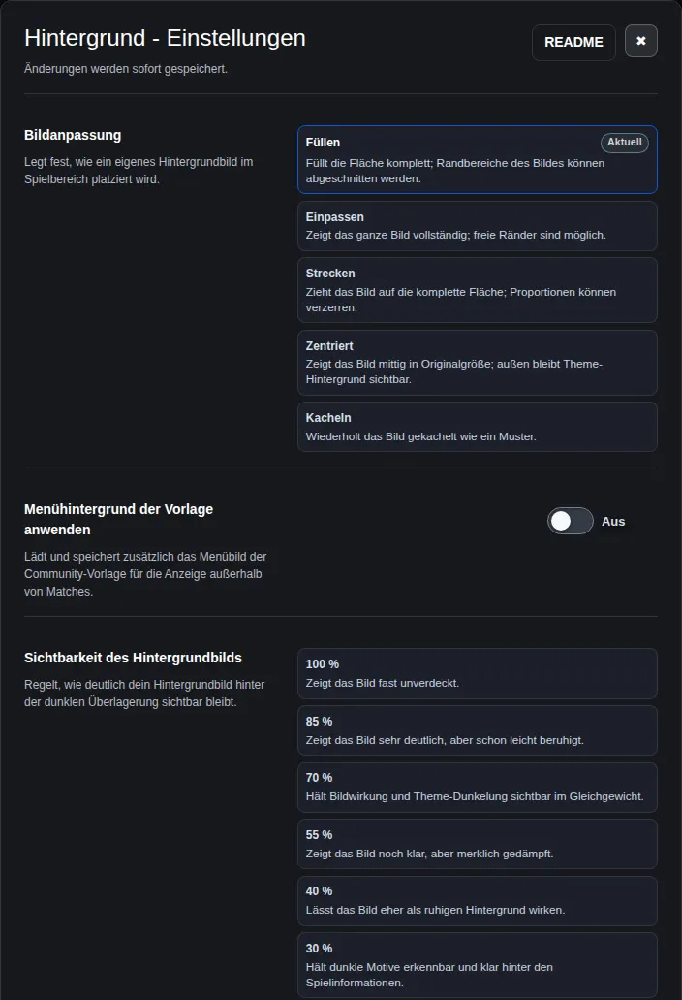

<a id="template-global-typography"></a>

### Schrift & Farben

- Gilt für: `alle Modi`
- Was macht es sichtbar? Wendet Schrift und Farben auf ausgewählte Bereiche an, kann aktive Spielerkarten einfärben und skaliert den X01-Restscore unabhängig von Namen und Statistiken.
- Wann sinnvoll? Wenn Scores, Würfe oder Namen einheitlich lesbar sein oder X01-Restscores separat hervorgehoben werden sollen.

[Alle Einstellungen und Optionen in der Feature-Referenz](docs/FEATURES.md#template-global-typography)

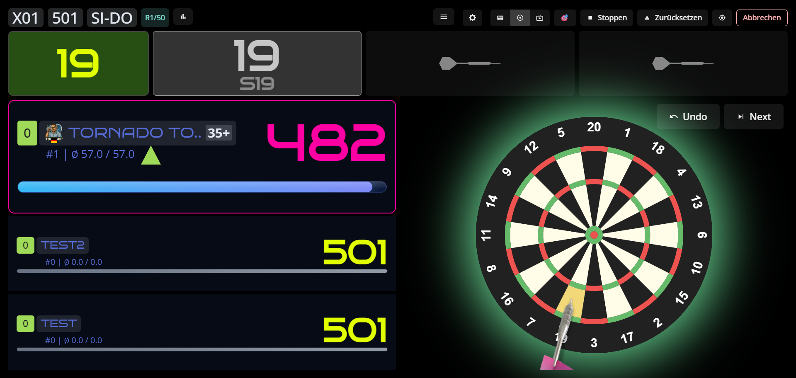

<a id="theme-game-layout"></a>

### Spiel-Layout

- Gilt für: `alle Modi`
- Was macht es sichtbar? Bildschirmprofile ordnen Spieler oder Tabelle und Board passend zum verfügbaren Platz an. Unklare Oberflächen bleiben unverändert.
- Wann sinnvoll? Wenn das Board im Querformat möglichst groß sein und trotzdem jeder Spieler schnell erfassbar bleiben soll.

[Alle Einstellungen und Optionen in der Feature-Referenz](docs/FEATURES.md#theme-game-layout)

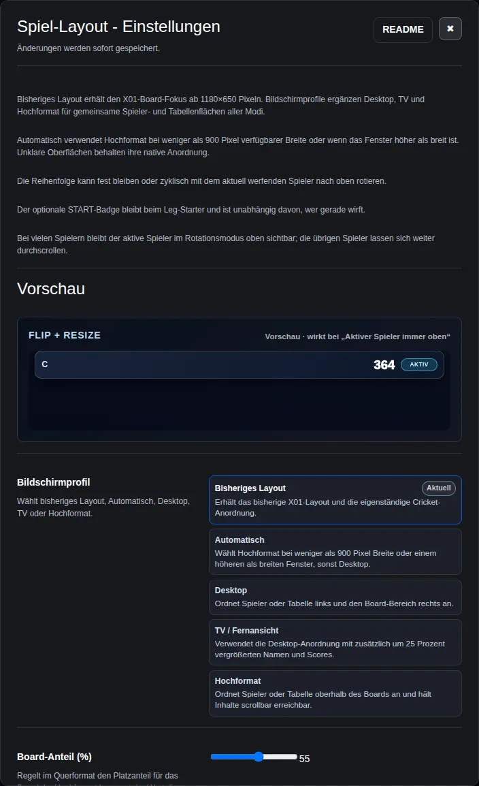

## Alle Modi

<a id="live-board-enhancement"></a>

### Livebild optimieren

- Gilt für: `alle Modi`
- Was macht es sichtbar? Verbessert Schärfe und Kontrast des angezeigten Kamerabilds. Die Darterkennung bleibt unverändert.
- Wann sinnvoll? Wenn das Livebild auf dem Spielmonitor zu weich wirkt.

[Alle Einstellungen und Optionen in der Feature-Referenz](docs/FEATURES.md#live-board-enhancement)

<a id="board-surround"></a>

### Board-Surround

- Gilt für: `alle Modi`
- Was macht es sichtbar? Das Motiv wird beim ersten Aktivieren geladen und dauerhaft gespeichert. Danach ist es offline verfügbar. Der Surround bleibt beim Checkout-Zoom stehen und lässt das Board frei.
- Wann sinnvoll? Wenn die Scheibe einen passenden Rahmen erhalten soll.

[Alle Einstellungen und Optionen in der Feature-Referenz](docs/FEATURES.md#board-surround)

<a id="bot-board-style"></a>

### Dartboard-Design

- Gilt für: `alle Modi`
- Was macht es sichtbar? Die native Board-Fläche wird durch ein ausgewähltes, lokal eingebettetes Board-Design ersetzt.
- Wann sinnvoll? Wenn Bot-Partien ein eigenes Board erhalten sollen oder du dasselbe Board-Design in allen unterstützten Matches verwenden möchtest.

[Alle Einstellungen und Optionen in der Feature-Referenz](docs/FEATURES.md#bot-board-style)

<a id="animation-autodarts-animate-avg-trend-arrow"></a>
<a id="animation-autodarts-animate-average-trend-arrow"></a>

### AVG-Trend anzeigen

- Gilt für: `alle Modi`
- Was macht es sichtbar? Ein kleiner Pfeil direkt am AVG zeigt kurz die Trendrichtung.
- Wann sinnvoll? Wenn du Formwechsel während eines Legs schnell am AVG erkennen möchtest.

[Alle Einstellungen und Optionen in der Feature-Referenz](docs/FEATURES.md#animation-autodarts-animate-avg-trend-arrow)

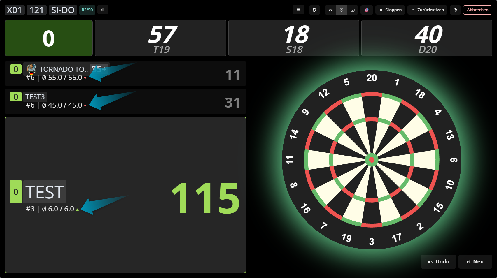

<a id="animation-autodarts-animate-dartboard-marker-highlight"></a>
<a id="animation-autodarts-animate-dart-marker-emphasis"></a>
<a id="animation-autodarts-animate-dart-marker-replacer"></a>
<a id="animation-autodarts-animate-dart-marker-darts"></a>

### Board-Treffermarkierungen

- Gilt für: `alle Modi`
- Was macht es sichtbar? Eine gemeinsame Kachel bietet native Treffermarker und Dart-Bilder mit getrennten Schaltern.
- Wann sinnvoll? Wenn die Standardmarker zu klein oder zu unauffällig sind.

[Alle Einstellungen und Optionen in der Feature-Referenz](docs/FEATURES.md#animation-autodarts-animate-dartboard-marker-highlight)


<a id="animation-autodarts-animate-take-out-darts-alert"></a>
<a id="animation-autodarts-animate-remove-darts-notification"></a>

### Hinweis: Darts entfernen

- Gilt für: `alle Modi`
- Was macht es sichtbar? Der Hinweis zum Entfernen der Darts wird als große Grafik deutlich präsenter dargestellt.
- Wann sinnvoll? Wenn der Standardhinweis zu leicht übersehen wird.

[Alle Einstellungen und Optionen in der Feature-Referenz](docs/FEATURES.md#animation-autodarts-animate-take-out-darts-alert)


<a id="animation-autodarts-animate-single-bull-hit-sound"></a>
<a id="animation-autodarts-animate-single-bull-sound"></a>

### Ton bei Single Bull

- Gilt für: `alle Modi`
- Was macht es sichtbar? Bei Single Bull hörst du einen kurzen Ton; grafisch bleibt das Spiel unverändert.
- Wann sinnvoll? Wenn du Single Bull akustisch schneller bestätigen möchtest, ohne auf eine zusätzliche Animation zu achten.

[Alle Einstellungen und Optionen in der Feature-Referenz](docs/FEATURES.md#animation-autodarts-animate-single-bull-hit-sound)

<a id="animation-autodarts-animate-turn-score-counter"></a>
<a id="turn-dart-display"></a>
<a id="animation-autodarts-animate-special-hit-highlights"></a>
<a id="animation-autodarts-animate-triple-double-bull-hits"></a>
<a id="animation-autodarts-animate-turn-points-count"></a>

### Wurfanzeige

- Gilt für: `alle Modi`
- Was macht es sichtbar? Dart-Symbole, Trefferfarben und Animationen der Wurfsumme lassen sich unabhängig einstellen.
- Wann sinnvoll? Wenn du Punktwechsel im Spielbild leichter verfolgen möchtest.

[Alle Einstellungen und Optionen in der Feature-Referenz](docs/FEATURES.md#animation-autodarts-animate-turn-score-counter)

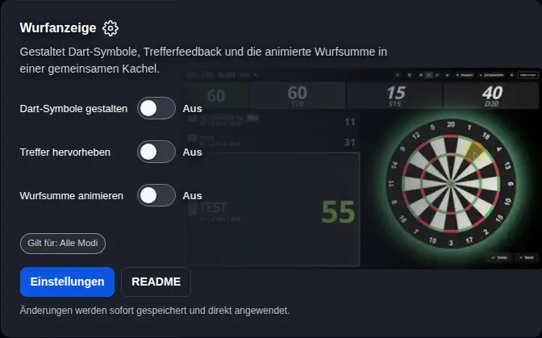

## X01

<a id="animation-autodarts-animate-checkout-score-highlight"></a>
<a id="animation-autodarts-animate-checkout-score-pulse"></a>
<a id="animation-autodarts-x01-remaining-score-bar"></a>
<a id="animation-autodarts-x01-score-progress"></a>

### X01-Restscore

- Gilt für: `X01`
- Was macht es sichtbar? Eine gemeinsame Kachel bietet die Hervorhebung der aktiven Restpunktzahl und einen Restscore-Balken je Spieler.
- Wann sinnvoll? Wenn du Checkout-Momente schneller am Score erkennen möchtest.

[Alle Einstellungen und Optionen in der Feature-Referenz](docs/FEATURES.md#animation-autodarts-animate-checkout-score-highlight)

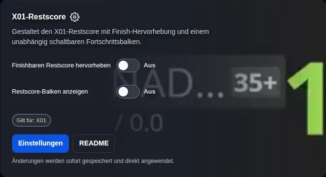

<a id="animation-autodarts-animate-checkout-target-highlights"></a>
<a id="animation-autodarts-animate-checkout-board-targets"></a>

### Checkout-Ziele hervorheben

- Gilt für: `X01`
- Was macht es sichtbar? Unter `180` wird das nächste sinnvolle Checkout-Ziel direkt am virtuellen Board markiert.
- Wann sinnvoll? Wenn du in der Checkout-Phase immer direkt am Board sehen willst, welches Feld als Nächstes sinnvoll ist.

[Alle Einstellungen und Optionen in der Feature-Referenz](docs/FEATURES.md#animation-autodarts-animate-checkout-target-highlights)

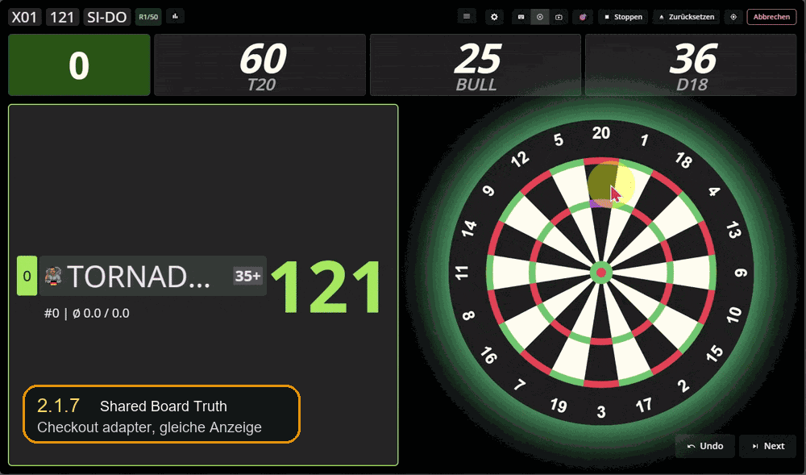

<a id="animation-autodarts-animate-tv-board-zoom"></a>

### Automatischer Board-Zoom

- Gilt für: `X01`
- Was macht es sichtbar? Bei klaren X01-Zielsituationen zoomt die Ansicht auf relevante Board-Bereiche und hält den Fokus in sinnvollen Finish-Momenten stabil. Optional fährt `Cinematic` mit sanftem Anlauf und Abbremsen wie eine Zoomlinse ein und aus.
- Wann sinnvoll? Wenn du bei dritten Darts und Finishes mehr Fokus auf Zielbereiche willst, aber bei Korrekturen schnell wieder die ganze Scheibe brauchst.

[Alle Einstellungen und Optionen in der Feature-Referenz](docs/FEATURES.md#animation-autodarts-animate-tv-board-zoom)

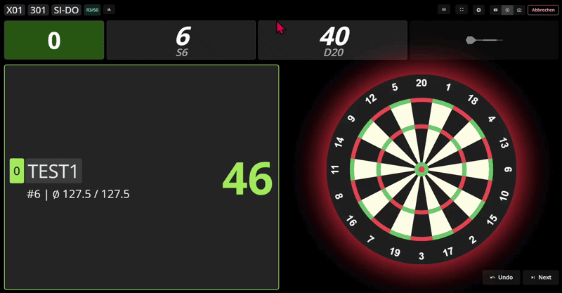

<a id="animation-autodarts-checkout-suggestion-styles"></a>
<a id="animation-autodarts-style-checkout-suggestions"></a>

### Checkout-Vorschlag gestalten

- Gilt für: `X01`
- Was macht es sichtbar? Die drei Turn-Felder werden bei Aktivierung größer; sichtbare Checkout-Empfehlungen erhalten den gewählten Akzentstil.
- Wann sinnvoll? Wenn du größere Turn-Felder und klar erkennbare Checkout-Routen möchtest, ohne dein Theme zu übergehen.

[Alle Einstellungen und Optionen in der Feature-Referenz](docs/FEATURES.md#animation-autodarts-checkout-suggestion-styles)

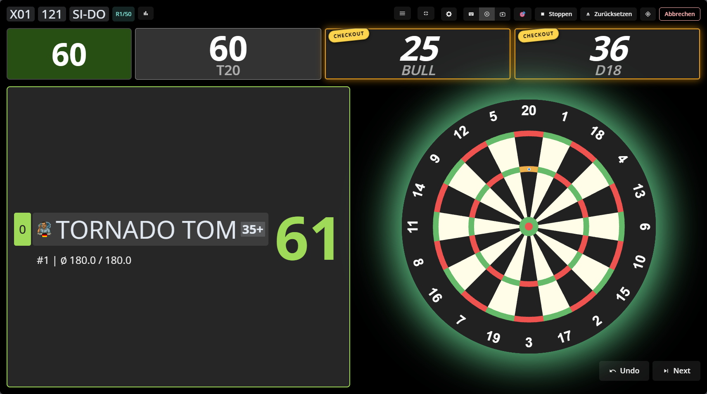

<a id="animation-autodarts-x01-bust-active-player-highlight"></a>

### Überworfen (BUST) hervorheben

- Gilt für: `X01`
- Was macht es sichtbar? Bei sichtbarem `BUST` wird der native Animationseffekt in der aktiven X01-Spielerkarte ausgeblendet und durch die xConfig-Markierung auf der Spielerkachel, dem Board oder der gesamten Spielfläche ersetzt. Die Option `Bildschirm – Darts-Einschlag` verwendet zuerst die tatsächlich gerenderte Position des letzten Darts und zeigt dort Einschlagloch und Glasrisse; fehlt der Marker, dienen übermittelte Koordinaten und zuletzt die Boardmitte als Fallback. Board- und Vollbild-Overlay lassen sich mit einem Klick für den aktuellen BUST ausblenden. BUST-Anzeige und roter Rahmen des Zugbereichs bleiben erhalten.
- Wann sinnvoll? Wenn ein Überwurf je nach Bildschirmaufbau lokal oder besonders großflächig auffallen soll.

[Alle Einstellungen und Optionen in der Feature-Referenz](docs/FEATURES.md#animation-autodarts-x01-bust-active-player-highlight)

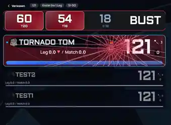

## Cricket / Tactics

<a id="cricket-tactics-layout"></a>
<a id="animation-autodarts-animate-cricket-grid-status-effects"></a>
<a id="animation-autodarts-animate-cricket-grid-fx"></a>

### Cricket-/Tactics-Tabelle

- Gilt für: `Cricket`, `Tactics`
- Was macht es sichtbar? Eine gemeinsame Tabellenkachel bietet Layout und Status/Effekte mit getrennten Schaltern.
- Wann sinnvoll? Wenn du die Tabelle besser lesen und Fortschritt sowie Gegnerdruck schneller erkennen möchtest.

[Alle Einstellungen und Optionen in der Feature-Referenz](docs/FEATURES.md#cricket-tactics-layout)

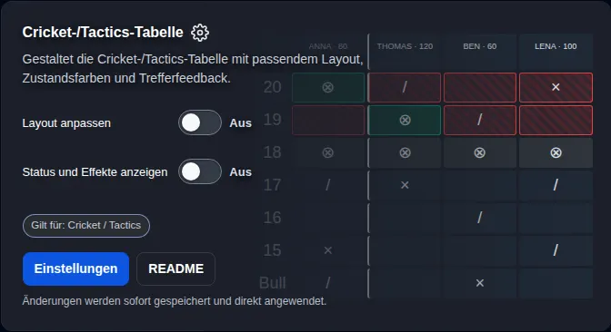

<a id="animation-autodarts-animate-cricket-target-highlighter"></a>
<a id="animation-autodarts-animate-cricket-highlighter"></a>

### Cricket-Ziele hervorheben

- Gilt für: `Cricket`, `Tactics`
- Was macht es sichtbar? Zielzustände und Drucksituationen werden direkt am Board sichtbar.
- Wann sinnvoll? Wenn du in Cricket oder Tactics schneller sehen möchtest, welche Ziele offen, scorable, unter Druck oder bereits erledigt sind.

[Alle Einstellungen und Optionen in der Feature-Referenz](docs/FEATURES.md#animation-autodarts-animate-cricket-target-highlighter)

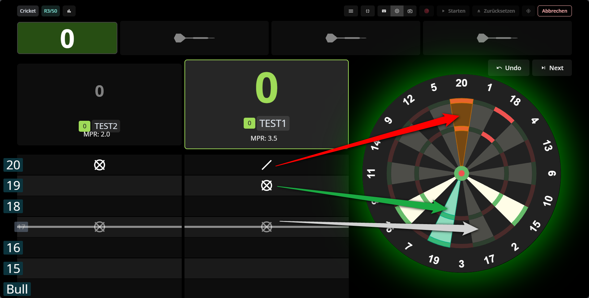
<!-- xconfig-generated:end -->

## Globales Hintergrundbild


In der Kachel **Hintergrund** verwaltest du ein gemeinsames Wallpaper für Spielansichten unter `/matches`. Eigene Bilder werden lokal verarbeitet und bis zum dokumentierten Limit von 1,5 MiB gespeichert. Du kannst die Bildanpassung, Sichtbarkeit und Transparenz der Spielerfelder getrennt einstellen. Eine angewendete Designvorlage kann das bestehende Wallpaper ersetzen, ohne die Dart-Symbole in der Wurfanzeige zu verändern.

## Bildschirmprofile und Community-Designs


**Spiel-Layout** bietet `Bisheriges Layout`, `Automatisch`, `Desktop`, `TV` und `Hochformat`. Der automatische Modus wechselt bei schmalen oder hohen Fenstern; Board-Anteil, Textgröße, Nebenanzeigen, Spielerreihenfolge und Wechsel-Effekt sind anpassbar. Bei unbekanntem oder unvollständigem DOM bleibt die native Darstellung erhalten.

**Designvorlagen** kombinieren Hintergrund, Schrift und Farben. Die Galerie enthält mitgelieferte und Community-Vorlagen, die durchsucht werden können. Ein zugeordneter Surround oder Glow wird nur übernommen, wenn die entsprechende Option aktiv ist. Die Wirkung der Vorlagen ist global; Bildschirmprofile und Spielfunktionen bleiben getrennt einstellbar.

[Quellen und Importverfahren der Community-Vorlagen](src/assets/theme-presets/community/README.md) · [Alle Designoptionen](docs/FEATURES.md#theme-global-presets)

## Einstellungen exportieren und importieren

Mit **Exportieren** erhältst du ein versioniertes JSON-Backup. Eigene Bilder können auf Wunsch eingeschlossen werden; ohne Bilder ist die Datei kleiner. Es werden keine Autodarts-Anmeldedaten exportiert.

Beim **Importieren** werden Werte vor dem Speichern geprüft. Unbekannte oder nicht mehr unterstützte Einstellungen werden ausgelassen. Du kannst **Sicher zusammenführen** (nur gültige Backup-Werte übernehmen) oder **Vollständig ersetzen** (aktuelle Standardkonfiguration plus gültige Backup-Werte) auswählen. Erst **Import bestätigen** schreibt die neue Konfiguration.

**Empfohlene Standards** setzt kuratierte Werte, deaktiviert aber alle Module und lässt eigene Uploads erhalten. **↺ Zurücksetzen** setzt sämtliche Module auf ihre Ausgangswerte zurück und entfernt auch das globale Wallpaper und den eigenen Dart-Upload. Ein Backup ist vor dem vollständigen Zurücksetzen sinnvoll.

## Updates erkennen und installieren

xConfig zeigt verfügbare Updates im Profilmenü und in der eigenen Oberfläche an. Über **Was ist neu?** kommst du zum Changelog; **Neu prüfen** startet eine zusätzliche Versionskontrolle. **Update installieren** öffnet die vollständige `.user.js`-Datei zur Bestätigung in Tampermonkey. Die automatische Prüfung verwendet die kleinere `.meta.js`-Datei.

Eine bestehende Konfiguration bleibt bei Updates grundsätzlich erhalten. Bei Problemen prüfe die installierte Version in Tampermonkey und installiere die aktuelle [stabile Version](https://github.com/thomasasen/autodarts-xconfig/releases/latest) erneut.

## Kompatibilität und Einschränkungen

xConfig ist eine inoffizielle Erweiterung für die aktuelle Autodarts-Weboberfläche. Die Darstellung hängt von den von Autodarts gelieferten DOM-Strukturen ab. Nicht jede Kombination aus Browser, Bildschirm, Spielmodus, Kamera und Drittanbieter-Erweiterung ist live geprüft. Wenn ein Element nicht zuverlässig erkannt wird, kann die Funktion ausbleiben, ohne die Spiellogik zu beeinflussen. Animationen können durch reduzierte Bewegung des Betriebssystems eingeschränkt werden.

**Livebild optimieren** verändert nur die Darstellung des Kamerabildes, nicht die Darterkennung. **Cricket/Tactics** verfügt über eigene Tabellen- und Zielzustände. Die in dieser README gezeigten xConfig-Dialoge stammen aus reproduzierbaren Browser-Fixtures mit dem aktuellen Renderer, nicht aus einem privaten Autodarts-Konto.

## Wenn xConfig nicht erscheint

1. In Tampermonkey prüfen, ob `autodarts-xconfig` installiert und aktiviert ist.
2. `https://play.autodarts.com/` neu laden und das Profilmenü erneut öffnen.
3. Bei Browser- oder Tampermonkey-Hinweisen die Nutzerscript-Ausführung beziehungsweise Injection-Einstellungen prüfen.
4. Sicherstellen, dass die Installation des vollständigen `.user.js`-Skripts bestätigt wurde, und doppelte ältere Kopien deaktivieren.
5. Bei weiterhin fehlender Oberfläche Browser, Tampermonkey-Version, xConfig-Version und Fehlermeldungen in einem [GitHub-Issue](https://github.com/thomasasen/autodarts-xconfig/issues/new) dokumentieren.

## Weitere Dokumentation

- [Ausführliche Feature-Referenz mit allen Feldern und Optionen](docs/FEATURES.md)
- [Changelog](CHANGELOG.md)
- [Technische Architektur](docs/TECHNICAL-ARCHITECTURE.md)
- [Runtime-Entrypoints](docs/RUNTIME-ENTRYPOINTS.md)
- [QA-Checkliste](docs/QA-CHECKLIST.md)
- [Dart-Regeln](docs/DART-RULES-REFERENCE.md)

## Für Entwickler

Die Feature-Beschreibungen werden aus `src/features/xconfig-ui/copy.js`, `descriptors.js` und `presentation-groups.js` über `scripts/sync-xconfig-docs.mjs` synchronisiert. Änderungen an den generierten Bereichen gehören deshalb in die Quellen, nicht nur in die Markdown-Dateien. Screenshots mit dem aktuellen Renderer lassen sich über `scripts/capture-xconfig-docs.mjs` in einem isolierten Playwright-Testaufbau neu aufnehmen.

```bash
npm ci
npm run sync:xconfig-docs
node --test tests/runtime/readme-docs.test.js
# Für lokale Screenshot-Aufnahmen: Chromium und ffmpeg installieren
node scripts/capture-xconfig-docs.mjs
```

Die generierten Abschnitte beginnen bei `<!-- xconfig-generated:start -->` und enden bei `<!-- xconfig-generated:end -->`. Runtime-Dateien und Spiellogik sind von dieser Dokumentation getrennt.
